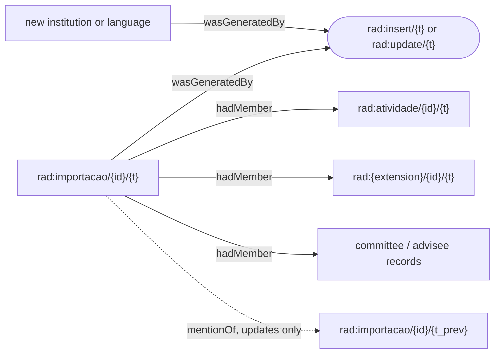

# PROVGov-SoS

**Provenance-based data governance for Systems-of-Systems**

PROVGov-SoS is an approach to data governance in Systems-of-Systems (SoS), where data produced by one system is consumed by others. It works by capturing and managing provenance: for every record that enters a system, it keeps which import created or changed it, when, what came in alongside it, and which earlier version it replaced or invalidated. With that trail, users can follow the life cycle of the data across systems and audit how a record reached its current state.

This repository holds the implementation of that approach inside a real SoS at UFF: the provenance layer added to `sisiad-consumidor-rad`, the SisIAD module that imports faculty-activity records from RAD.

> **Paper:** J. M. de Almeida, V. Braganholo, D. de Oliveira. *Governança de Dados em Sistemas-de-Sistemas: Uma Abordagem Orientada à Dados de Proveniência.* XL Simpósio Brasileiro de Banco de Dados (SBBD 2025), pp. 182–195. [doi:10.5753/sbbd.2025.247059](https://doi.org/10.5753/sbbd.2025.247059)

---

## Contents

- [How it works](#how-it-works)
  - [1. Provenance model](#1-provenance-model)
  - [2. Capturing side effects with AspectJ](#2-capturing-side-effects-with-aspectj)
  - [3. Storage](#3-storage)
  - [4. Graph export to Neo4j](#4-graph-export-to-neo4j)
- [Repository layout](#repository-layout)
- [Technology stack](#technology-stack)
- [Building](#building)
- [Glossary](#glossary)
- [Citation](#citation)
- [Authors](#authors)

---

## How it works

```
RAD ──► sisiad-consumidor-rad ──► ProvenanceRADService ──► RADOC.PROV (Oracle, PROV-JSON)
             │   (import)              ▲                          │
             │                         │                          ▼
             └── AspectJ aspects ──────┘                 jsonTocypher ──► Neo4j
                 (side-effect records)                   (provenance graph)
```

Each time the consumer imports a record from RAD, `ProvenanceRADService` builds a [W3C PROV](https://www.w3.org/TR/prov-dm/) document describing that import. The document is serialized as PROV-JSON and stored next to the operational data. A separate utility can then load the stored documents into Neo4j for graph queries.

### 1. Provenance model

Every import becomes a named PROV **bundle** `rad:bundle/{importId}/{t}`, where `t` is the import timestamp in epoch milliseconds and the `rad` prefix is bound to `https://app.uff.br/rad#`. Identifiers inside the bundle follow the pattern `rad:{prefix}/{id}/{t}`; the prefixes are defined in `util/ProvConstants.java`.

| PROV element | Identifier | Meaning |
|---|---|---|
| `prov:Entity` | `rad:importacao/{id}/{t}` | The import record. It also acts as a collection of everything the import brought in. |
| `prov:Entity` | `rad:atividade/{id}/{t}` or `rad:produto/{id}/{t}` | The faculty activity or product (output) being imported. |
| `prov:Entity` | `rad:{extension}/{id}/{t}` | The type-specific extension of an activity (graduate class, administration, leave, special activity, advising, closure). |
| `prov:Activity` | `rad:insert/{t}`, `rad:update/{t}`, `rad:invalidated/{t}` | The import operation, with its start time. |
| `wasGeneratedBy` | — | The import entity, and any new institution or language records, were generated by the operation. |
| `hadMember` | — | Links the import to its activity or product, its extension, and related records (examination committees, advisees, product authors, knowledge areas). |
| `mentionOf` | — | On updates, links the new import entity to the previous version and the bundle that holds it. |
| `wasInvalidatedBy` | — | On deletions, marks the most recent upserted version as invalidated. |

Each entity stores the name of its source table in `prov:location` and `RECORD` in `prov:type`. A snapshot of the domain object's non-public fields, captured by reflection, goes in `prov:value`. Extension entities also record which fields were ignored during the import (`ignoredFields`).

An insert or update of an activity produces a bundle like this:



A deletion produces a smaller bundle: a `rad:invalidated/{t}` activity and a `wasInvalidatedBy` relation pointing at the last upserted version of the import.

### 2. Capturing side effects with AspectJ

Some imports create records as a side effect. For example, registering an examination committee (`BancaRADService.criaEspecialBanca`) can insert a new institution, and registering a product (`ProdutoRADService.criaProduto`) can insert a new language. These inserts happen deep inside the import code, so they are captured with AspectJ rather than by threading provenance calls through every service:

1. Annotate the method that may create the record with `@TraceInstituicaoCreationMethod` or `@TraceIdiomaCreationMethod`.
2. Make the class that declares the method extend `ProvenanceExtension`, which holds the `ProvenanceRADService` for the current import.
3. While the annotated method runs, `InstituicaoAspect` or `IdiomaAspect` watches for `InstituicaoRADDAO.save(..)` or `IdiomaRADDAO.insert(..)` to return. When the method finishes, any newly created object is added to `ProvenanceRADService.getObjetosSecundarios()`.
4. When the bundle is built, every object in that set becomes an entity. Committee, advisee, author and knowledge-area records are attached with `hadMember`; institutions and languages with `wasGeneratedBy`.

The aspects use `percflow` instantiation, so each annotated call gets its own aspect instance instead of sharing a singleton.

```java
// Sketch: how a service opts in to side-effect capture
@Service
public class BancaRADService extends ProvenanceExtension {

    public BancaRADService(ProvenanceRADService provenanceRADService /*, other DAOs */) {
        super(provenanceRADService);
    }

    @TraceInstituicaoCreationMethod
    public BancaRAD criaEspecialBanca(/* ... */) {
        // ... may call instituicaoRADDAO.save(novaInstituicao);
        //     the aspect records the new institution for the provenance bundle
    }
}
```

Committee, advisee, author and knowledge-area records have no aspect. The calling code adds them to `getObjetosSecundarios()` directly.

### 3. Storage

`ProvenanceRADService.save(...)` builds the bundle, serializes it to PROV-JSON, and inserts it through `ProvenanceDAO` into the Oracle table `RADOC.PROV`:

| Column | Content |
|---|---|
| `ID` | Import identifier |
| `DATA_IMPORTACAO` | Import timestamp |
| `PROV_JSON` | The PROV-JSON document |
| `OP` | Operation: `UPSERT` or `DELETE` |

Updates and deletions look up the latest `UPSERT` row for the same `ID` (`findFirstByIdAndOpOrderByData_ImportacaoDesc`). That is how the `mentionOf` and `wasInvalidatedBy` relations find the previous version.

The repository does not ship DDL. A minimal definition consistent with the code is:

```sql
CREATE TABLE RADOC.PROV (
    ID               NUMBER       NOT NULL,
    DATA_IMPORTACAO  TIMESTAMP    NOT NULL,
    PROV_JSON        CLOB         NOT NULL,
    OP               VARCHAR2(20) NOT NULL
);
```

`ExtensaoProvenanceService` can also serialize documents to PROV-N (`documentToPROVN`), which is handy for inspecting a bundle by eye.

### 4. Graph export to Neo4j

`util/jsonTocypher.java` is a standalone program (`main`). It reads the stored documents over JDBC from a query that returns a `prov_json` column, parses each one with ProvToolbox, and writes one transaction per bundle to Neo4j:

| Neo4j | From |
|---|---|
| `(:Entity {name, ...fields})` | Each PROV entity, with its `prov:value` fields as node properties |
| `-[:HAD_MEMBER]->` | `hadMember` |
| `-[:MENTION]->` | `mentionOf` (new version → previous version) |
| `-[:invalidated {time}]->` (self-relationship) | `wasInvalidatedBy` |

Before running it, set the `dbUri`, `dbUser`, `dbPassword` and `QUERY` constants, which are empty in the repository. The exporter also needs `neo4j-java-driver`, `commons-lang3`, and two helper classes (`org.example.JDBCUtils` and `org.example.convert.KeyValueParser`). None of these are declared in this module's `pom.xml` or included in the repository.

Example queries over the exported graph:

```cypher
// Version history of an import
MATCH path = (:Entity {name: 'importacao/42/1700000000000'})-[:MENTION*]->(:Entity)
RETURN path;

// Everything an import brought in
MATCH (imp:Entity)-[:HAD_MEMBER]->(m:Entity)
WHERE imp.name STARTS WITH 'importacao/42/'
RETURN imp.name, m.name;

// Invalidated (deleted) records and when they were invalidated
MATCH (e:Entity)-[r:invalidated]->(e)
RETURN e.name, r.time;
```

The exporter currently writes entities, memberships, mentions and invalidations. Activities and `wasGeneratedBy` relations are parsed but not exported.

---

## Repository layout

```
sisiad-consumidor-rad/
├── pom.xml
└── src/main/java/br/uff/sti/sisiad/consumidor/rad/
    ├── annotations/   @TraceInstituicaoCreationMethod, @TraceIdiomaCreationMethod
    ├── aspects/       InstituicaoAspect.aj, IdiomaAspect.aj
    ├── dao/           ProvenanceDAO: reads and writes RADOC.PROV
    ├── modelo/        ProvenanceData: mapping of RADOC.PROV
    ├── provenance/    ProvenanceRADService: builds and stores PROV bundles
    │                  ExtensaoProvenanceService: PROV helpers (entities, serialization, reflection)
    │                  ProvenanceExtension: base class for services the aspects observe
    └── util/          ProvConstants: identifier prefixes
                       jsonTocypher: PROV-JSON → Neo4j exporter
```

## Technology stack

- **Java** (14 or later, since the code uses switch expressions) and **Spring Boot** (JDBC, AMQP, Web, Actuator)
- **[ProvToolbox](https://github.com/lucmoreau/ProvToolbox) 2.0.4** (`prov-model`, `prov-interop`) to build and serialize PROV documents
- **AspectJ 1.9.19** with compile-time weaving
- **Oracle Database** (`ojdbc8`) to store provenance
- **Neo4j** for graph export and querying
- **Lombok**

## Building

> **Note:** This repository contains only the provenance-related part of `sisiad-consumidor-rad`. It does not build on its own.

The module expects the rest of the SisIAD code base:

- the parent POM `br.uff.sti:sisiad-base-app:1.7.1`, resolved from `../sisiad-base-app`, which also defines `java.version` and `aspectj.version`
- the shared library `br.uff.sti:sisiad-lib`
- the application class `br.uff.sti.sisiad.consumidor.rad.ImportaRadApplication`
- the RAD domain model and DAOs referenced by the services and aspects (`ImportacaoRAD`, `AtividadeRAD`, `ProdutoRAD`, `ExtensaoAtividade`, `InstituicaoRAD`, `IdiomaRAD`, `BancaRAD`, `InstituicaoRADDAO`, `IdiomaRADDAO`, …)

With those available, build the module as usual:

```bash
cd sisiad-consumidor-rad
mvn package
```

The build weaves the aspects in two steps. First, `maven-compiler-plugin` compiles the Java sources into `target/unwoven-classes`. Then, in the `process-classes` phase, `aspectj-maven-plugin` weaves the aspects from `aspects/` into those classes. To reuse the provenance layer in another Spring application, copy the `annotations`, `aspects`, `dao`, `modelo`, `provenance` and `util` packages and keep the same two-step build configuration.

## Glossary

Identifiers in the code are in Portuguese:

| Portuguese | English |
|---|---|
| importação | import |
| atividade | (faculty) activity |
| produto | product, academic output |
| extensão | extension (type-specific details of an activity) |
| banca | examination committee |
| orientação / orientando | advising / advisee |
| instituição | institution |
| idioma | language |
| área de conhecimento | knowledge area |
| afastamento | leave of absence |
| encerramento | closure |
| objetos secundários | secondary objects (records created as side effects) |

## Citation

If you use PROVGov-SoS, please cite:

```bibtex
@inproceedings{almeida2025provgovsos,
  author    = {J{\'e}ssica Mon{\c{c}}{\^o}res de Almeida and Vanessa Braganholo and Daniel de Oliveira},
  title     = {Governan{\c{c}}a de Dados em Sistemas-de-Sistemas: Uma Abordagem Orientada {\`a} Dados de Proveni{\^e}ncia},
  booktitle = {Anais do XL Simp{\'o}sio Brasileiro de Banco de Dados (SBBD)},
  pages     = {182--195},
  year      = {2025},
  address   = {Fortaleza, CE, Brasil},
  publisher = {Sociedade Brasileira de Computa{\c{c}}{\~a}o},
  doi       = {10.5753/sbbd.2025.247059}
}
```

The approach and its architecture are described in more detail in Jéssica Monçôres's [master's dissertation](https://repositorio.marinha.mil.br/bitstream/20.500.14867/848015/1/Dissertacao_JessicaMoncores.pdf) (UFF).

## Authors

Developed by the [UFF eScience group](https://github.com/UFFeScience) at the Instituto de Computação, Universidade Federal Fluminense (UFF):

- Jéssica Monçôres de Almeida
- Vanessa Braganholo
- Daniel de Oliveira
